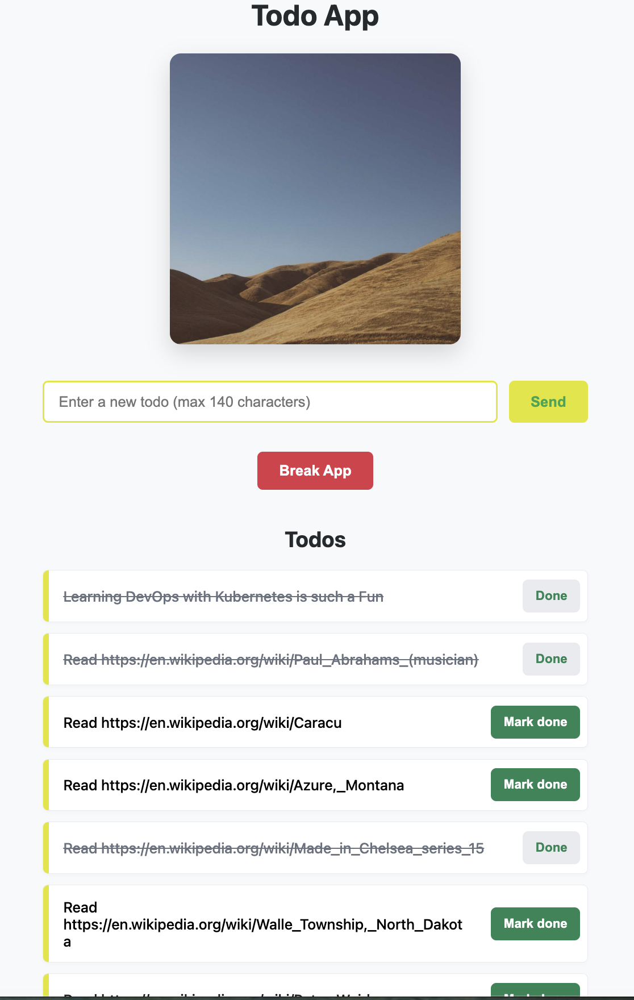

## 4.5. The project, step 22

- our existing todos table does not have boolean `done` yet, so lets add it first with default value `false`:

```sh
kubectl exec -it todo-postgres-0 -n project -- \
  psql -U postgres -d postgres -c \
  "ALTER TABLE todos ADD COLUMN done BOOLEAN NOT NULL DEFAULT FALSE;"
```

- now out table is:

```table
 Column |  Type   | Collation | Nullable |              Default
--------+---------+-----------+----------+-----------------------------------
 id     | integer |           | not null | nextval('todos_id_seq'::regclass)
 todo   | text    |           | not null |
 done   | boolean |           | not null | false
Indexes:
    "todos_pkey" PRIMARY KEY, btree (id)
```

- edit the /todo endpoint so that it returns or sends id, todo and done.

```javascript
const result = await pool.query("SELECT id, todo, done FROM todos ORDER BY id");
```

- the backend needs to handle requests that change a todo's completion status, so lets add a put endpoint like /todo:id.
- Now, create a docker image and import into k3d:

```sh
docker build -t khemrajneupane/todo_backend:ex-4.5 ./ex_4.5/todo_backend
```

```sh
k3d image import khemrajneupane/todo_backend:ex-4.5 -c k3s-default
```

- since we have other resourse already deployed in porject namespace, after this todo_backend changes in index.js and new image creation, lets set this current image only:

```sh
kubectl set image deployment/todo-backend \
  todo-backend=khemrajneupane/todo_backend:ex-4.5 \
  -n project
```

- testing the new /todo:id. lets run `kubectl port-forward svc/todo-backend-svc 3001:3001 -n project` in one terminal to portforward to 3001 for backend.
- temporarilly, lets turn done: true for id 1 todos:

```curl
curl -i -X PUT http://localhost:3001/todos/1 \
  -H 'Content-Type: application/json' \
  -d '{"done":true}'
```

- list all todos and check id 1:

```curl
curl http://localhost:3001/todos
```

- we get done: true- `[{"id":1,"todo":"Learning DevOps with Kubernetes is such a Fun","done":true}...`
- hence, the backend and the database work as expected.
- then todo_app's index.js is refactored to use the button, call the new put api at /todo:id and made the UI optimistic to immediately show the changes irrespective or db changes, but page refresh will be the point of truth.
- lets build image with tag ex-4.5:

```sh
docker build -t khemrajneupane/todo_app:ex-4.5 ./ex_4.5/todo_app
```

```sh
k3d image import khemrajneupane/todo_app:ex-4.5 -c k3s-default
```

- like for todo_backend, lets update the image of frontend todo_app

```sh
kubectl set image deployment/todo-app \
  todo-app=khemrajneupane/todo_app:ex-4.5 \
  -n project
```

- then update the pod:

```sh
kubectl rollout status deployment/todo-app -n project
```

- port forward frontend:

```sh
kubectl port-forward svc/todo-app-svc 3000:3000 -n project
```

- I have correct UI behaviors
  
