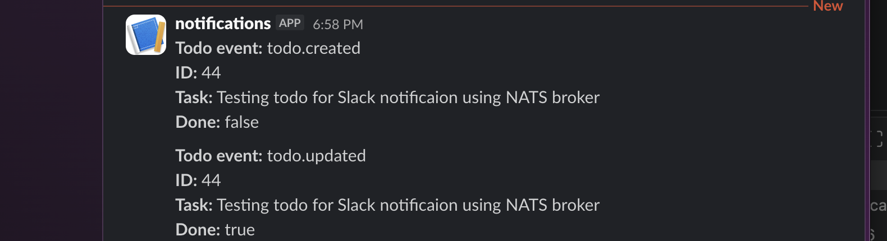
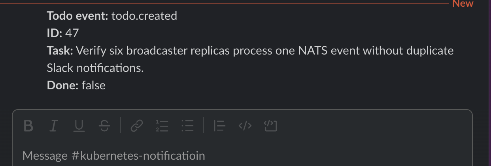

## 4.6. The project, step 23

- I want to send notification to Slack channel, so I created the workspace and channel, and Slack has provided a webhook URL and a sample curl request is working.
- We install NATS into a separate nats namespace to keep it distinct from your Todo app in project.
- lets use the Helm chart to install NATS under `nats` namespace into cluster in the following sequences:

```sh
helm repo add nats https://nats-io.github.io/k8s/helm/charts/
```

- then update repo:

```sh
helm repo update
```

```sh
helm upgrade --install my-nats nats/nats \
  --namespace nats \
  --create-namespace \
  --set promExporter.enabled=true
```

- verify nats pods:

```sh
kubectl get pods -n nats
```

- running successfully:

```table
NAME                           READY   STATUS    RESTARTSAGE
my-nats-0                      3/3     Running   080s
my-nats-box-7f8b679cd9-6tpq7   1/1     Running   080s
```

- check nats services also:

```sh
kubectl get svc -n nats
```

- installing the NATS client in `todo_backend` because the backend publishes Todo events to NATS after successfully creating or updating a Todo. The frontend (`todo_app`) does not need the NATS client because it communicates with the backend through HTTP.

```sh
npm install nats
```

- lets add a nats url in environment variable in deplyment.yaml, since it is not a secret so we don't need to put is in secrets deployment.

```yaml
- name: NATS_URL
  value: "nats://my-nats.nats.svc.cluster.local:4222"
```

- kubernetes provides a DNS name for services using this pattern `service-name.namespace.svc.cluster.local`, hence our NATS_URL value becomes `nats://my-nats.nats.svc.cluster.local:4222`
- we can also verify the above port:

```sh
kubectl get svc my-nats -n nats
```

```table
NAME      TYPE        CLUSTER-IP      EXTERNAL-IP   PORT(S)    AGE
my-nats   ClusterIP   10.43.204.164   <none>        4222/TCP   32m
```

- lets add the NATS import and connection setup in todo_backend/index.js and get them connected to create, update routes.
- we create a publishToDoEvent function and provide it necessary payloads after a todo is created/updated:

```javascript
await publishTodoEvent({
  type: "todo.created",
  todo: result.rows[0],
});
await publishTodoEvent({
  type: "todo.updated",
  todo: result.rows[0],
});
```

### build new image now:

```sh
docker build -t khemrajneupane/todo_backend:ex-4.6 ./ex_4.6/todo_backend
```

- import into k3d:

```sh
k3d image import khemrajneupane/todo_backend:ex-4.6 -c k3s-default
```

- apply kustomization from root, only changed ones will be configured others unchanged:

```sh
kubectl apply -k .
```

- current status of pods at this stage:

```sh
kubectl get pods -n project
```

```table
kubectl get pods -n project
NAME                            READY   STATUS      RESTARTS   AGE
todo-app-77d4cf858c-2wmx7       1/1     Running     0          17h
todo-backend-7dc5458ccb-lslg4   1/1     Running     0          2m19s
todo-generator-29863380-kzp8t   0/1     Completed   0          158m
todo-generator-29863440-7q5kx   0/1     Completed   0          98m
todo-generator-29863500-jj275   0/1     Completed   0          38m
todo-postgres-0                 1/1     Running     0          3d19h
```

- check backend logs:

```sh
kubectl logs deployment/todo-backend -n project
```

- it logs: `Todo backend is listening on port 3001`
- to test backend, lets port forward it temporarilly as below, because this service used ClusterIP so not reachable from outside. Port-forwarding will help us to access it from outside:

```sh
kubectl port-forward -n project svc/todo-backend-svc 3001:3001
```

- check healthz in anothr terminal:

```sh
curl -i http://localhost:3001/healthz
```

- returns: `{"status":"ok"}`, so backend todo is ok.
- lets actually post a todo:

```curl
curl -i -X POST http://localhost:3001/todos \
  -H "Content-Type: application/json" \
  -d '{"todo":"Test NATS event from Exercise 4.6"}'
```

- check backend logs:

```sh
kubectl logs deployment/todo-backend -n project --since=5m
```

```table
Received todo request
Todo accepted: Test NATS event from Exercise 4.6
Queued Todo event for publishing: todo.created
```

- so from above we can see, our current implementation publishes the event to NATS
- is NATS message broker healthy yet?

```sh
kubectl get pods -n nats
```

```table
NAME                           READY   STATUS    RESTARTS   AGE
my-nats-0                      3/3     Running   0          89m
my-nats-box-7f8b679cd9-6tpq7   1/1     Running   0          89m
```

- lets check if the subscriber is listening on `todos.events`

```sh
kubectl exec -it -n nats my-nats-box-7f8b679cd9-6tpq7 -- \
  nats sub todos.events --server nats://my-nats.nats.svc.cluster.local:4222
```

- with above commands that is listening on subscription, we add one more todo for testing:

```sh
curl -i -X POST http://localhost:3001/todos \
  -H "Content-Type: application/json" \
  -d '{"todo":"post todo-events delivery verifiation"}'
```

- we see then:
  `{"type":"todo.created","todo":{"id":38,"todo":"post todo-events delivery verifiation","done":false}}`
- so, it has confirmed that the backend publishes todo events and nats delivers them to a subscriber.
- lets put the `/brocaster` in a dedicated file in the root folder ex_4.6
- in `/broadcaster`we can initialize node and install nats client, because it is a dedicated project with node and nats clients:

```sh
npm init -y && npm install nats
```

- create a index.js inside broadcaster and add the NATS subscriber code
  - get NATS_URL from env variable
  - get connection with connect method from 'nats'
  - subscribe to todos.events and provide proper logging
- create a Dockerfile to build and use image of broadcaster

### build broadcaster image:

```sh
docker build -t todo-broadcaster:ex-4.6 ./ex_4.6/broadcaster
```

create deployment, kustomization for broadcaster because it is a dedicated resource.

- we create the actual `broadcaster-secret` ( SLACK_WEBHOOK_URL) directly in Kubernetes using local terminal, rather than putting the real webhook URL into GitHub repo.

```sh
kubectl create secret generic broadcaster-secret \
  --namespace project \
  --from-literal=SLACK_WEBHOOK_URL='actual SLACK_WEBHOOK_URL'
```

- kubernetes' secret service is created like above with `create secret generic ...` and we refered to `broadcast-secret`which is defined in deployment.yaml as:

```yaml
valueFrom:
  secretKeyRef:
    name: broadcaster-secret
    key: SLACK_WEBHOOK_URL
```

### import broadcaster image now:

```sh
k3d image import todo-broadcaster:ex-4.6 -c k3s-default
```

- apply kustomize for all resources from root:

```sh
kubectl apply -k .
```

```sh
kubectl get pods -n project
```

```table
NAME                            READY   STATUS      RESTARTS   AGE
broadcaster-cff97b8dd-kg7cd     1/1     Running     0          15s
todo-app-77d4cf858c-2wmx7       1/1     Running     0          18h
todo-backend-7dc5458ccb-lslg4   1/1     Running     0          84m
todo-generator-29863440-7q5kx   0/1     Completed   0          179m
todo-generator-29863500-jj275   0/1     Completed   0          119m
todo-generator-29863560-9qq9c   0/1     Completed   0          59m
todo-postgres-0                 1/1     Running     0          3d20h
```

- lets check broadcaster's logs:

```sh
kubectl logs deployment/broadcaster -n project
```

- above logs:

```table
Connected to NATS
Listening for Todo events
Received Todo event: {
  type: 'todo.created',
  todo: {
    id: 40,
    todo: 'Read https://en.wikipedia.org/wiki/Scopula_thysanopus',
    done: false
  }
}
```

- thus, our broadcaster is connected to NATS and has successfully received a real todo event
- now we add the Slack message-sending function in the broadcaster/index.js
- index.js uses SLACK_WEBHOOK_URL, received from the environment variable supplied by our Kubernetes secret that we created above.
- in index.js, we reate a function sendToSlack and what it should do is check secret, format event, send message, check response to Slack.

### after all changes, again build/import broadcaster image:

```sh

docker build --no-cache -t todo-broadcaster:ex-4.6-slack ./ex_4.6/broadcaster
```

```sh
k3d image import todo-broadcaster:ex-4.6-slack -c k3s-default
```

- apply again:

```sh
kubectl apply -k .
```

- wait for the update to finish

```sh
kubectl rollout status deployment/broadcaster -n project
```

- now lets port forward the todo_app(frontend) from where we can test put/post operations and check the Slack notifications at the same time.

```sh
kubectl port-forward -n project svc/todo-app-svc 8080:3000
```

### Notification in Slack:



- lets test with 6 replicas, change broadcaster's deployment.yaml, add 6 replicas `replicas: 6`
- we want to test if Kubernetes maintains 6 broadcaster Pods, they use the same NATS que group `todo-broadcasters`, will they share the work rather than sending the same event to Slack from each of them?

- apply again:

```sh
kubectl apply -k .
```

- wait for the update to finish

```sh
kubectl rollout status deployment/broadcaster -n project
```

- verify 6 po:

```sh
kubectl get pods -n project -l app=broadcaster
```

```table
NAME                          READY   STATUS    RESTARTS   AGE
broadcaster-8d49955f7-2cfgn   1/1     Running   0          36s
broadcaster-8d49955f7-76kf6   1/1     Running   0          36s
broadcaster-8d49955f7-fqt95   1/1     Running   0          60m
broadcaster-8d49955f7-fvn5x   1/1     Running   0          36s
broadcaster-8d49955f7-v79xs   1/1     Running   0          36s
broadcaster-8d49955f7-wf8c9   1/1     Running   0          36s
```

- hence, we have the broadcaster as 6 workers listening to the same NATS queue.
- add a new todo again and test to verify six broadcaster replicas process one NATS event without duplicate Slack notifications.

```sh
kubectl logs -n project -l app=broadcaster --prefix --since=5m
```

```table
[pod/broadcaster-8d49955f7-76kf6/broadcaster] Received Todo event: {
[pod/broadcaster-8d49955f7-76kf6/broadcaster]   type: 'todo.created',
[pod/broadcaster-8d49955f7-76kf6/broadcaster]   todo: {
[pod/broadcaster-8d49955f7-76kf6/broadcaster]     id: 47,
[pod/broadcaster-8d49955f7-76kf6/broadcaster]     todo: 'Verify six broadcaster replicas process one NATS event without duplicate Slack notifications.',
[pod/broadcaster-8d49955f7-76kf6/broadcaster]     done: false
[pod/broadcaster-8d49955f7-76kf6/broadcaster]   }
[pod/broadcaster-8d49955f7-76kf6/broadcaster] }
[pod/broadcaster-8d49955f7-76kf6/broadcaster] Slack notification sent for Todo event: todo.created
```

- Exactly, out of all 6 only one pod: `pod/broadcaster-8d49955f7-76kf6`got `todo.created`for id 47. And Slack also got the notification exactly for that id 47:
  
