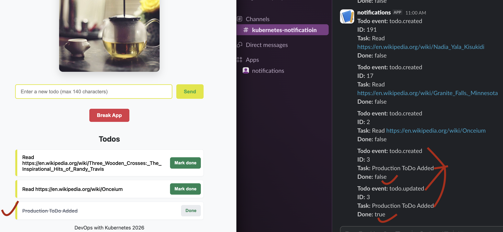

## 4.9. The project, step 25

### Staging for testing:

- Every new commit to the main branch is deployed and tested new changes before releasing them to users.
- The broadcaster logs Todo events but does not send Slack notifications.
- The database is not backed up.

### Production the real application:

- A tagged commit is deployed here as a release.
- The broadcaster logs Todo events and continues sending Slack notifications.
- The database is backed up.

### toggling staging/production:

- in broadcaster/index.js setting we use LOG_ONLY=boolean for following missions:
- LOG_ONLY=true is used for logging events only, no Slack messages go through for staging changes.
- LOG_ONLY=false is used for logging events along with sending Slack notifications for Production environment

### build new image with ex-4.9 tag:

```sh
docker build -t todo-broadcaster:ex-4.9 ./ex_4.9/broadcaster
```

- Import image into k3d:

```sh
k3d image import todo-broadcaster:ex-4.9 -c k3s-default
```

- organizing environments
  - base
  - overlays
    - Staging
    - Production
- I do the work in these orders:
- moving the shared application components into `base/` folder
- creating `staging` and `production` `overlays`
- giving each environment its own namespace and app storage
- configuring `staging` to log broadcaster messages only
- include database backups in production only
- configuring Argo CD for main and tagged releases.

### create base/kustomization.yaml:

- it will keep the common configuration that will be required by both `staging` and `production` environments.
- check the root kustomization of base:

```sh
kubectl kustomize ex_4.9/base
```

- create staging related kustomization.yaml and also `staging` namespace and add to staging/kustomization.yaml along with `broadcaster-patch.yaml`which will declare to use `LOG_ONLY=true` env.variable, replicas: 1 etc.
- let's validate if kustomization for staging is pulling all required config resources:

```sh
kubectl kustomize ex_4.9/overlays/staging
```

- create the production environment, where Slack notifications and database backups remain enabled. Keep `production` specific config resources into `/ex_4.9/overlays/production` just like for `stating`
- in production kustomization.yaml, this time we also add todo_backup
- create `production` related `kustomization.yaml` and also `production` namespace and add to `production/kustomization.yaml` along with `broadcaster-patch.yaml` which will declare to use `LOG_ONLY=false` env.variable, and `replicas: 6` etc.
- let's validate if kustomization for staging is pulling all required config

```sh
kubectl kustomize ex_4.9/overlays/production
```

- next, we need separate: Production/Staging: their own Todo app storage and PostgreSQL database.
- for staging persistentvolume path `/tmp/kube-staging`, `name: todo-app-pv-staging` etc and also create persistentvolumeclaim.
- to include the staging PV and PVC, add these `persistentvolume.yaml` and `persistentvolumeclaim.yaml` to staging's `kustomization.yaml`.

- for production also persistentvolume path `/tmp/kube-production`, `name: todo-app-pv-production` etc and also create persistentvolumeclaim.
- to include the production PV and PVC, add these `persistentvolume.yaml` and `persistentvolumeclaim.yaml` to production's `kustomization.yaml`.
- we need to create separate persistent storage for the production database backups name `todo-backup-pv-production` directory `/tmp/kube-backups-production`
- also create persistentvolumeclaim for backup `todo-backup-pv-production`
- these two backup persistentvolume and volumeclaim needs to be added to production kustomization only.
- create the backup dir on the node:

```sh
docker exec k3d-k3s-default-agent-0 mkdir -p /tmp/kube-backups-production
```

- this dir exists now: `drwxr-xr-x 2 root root 4096 Oct 26 22:05 /tmp/kube-backups-production`
- I have todo-backend-secret and broadcaster-secret created earlier in project namespace. Since, the production broadcaster needs the broadcaster secret in the production namespace, and the Todo backend needs its database secret there too, we just copy them into staging and production namespaces also. So, `todo-backend-secret` is copied to `staging` while `todo-backend-secret` and `broadcaster-secret` are copied to `production`
- next, we need to let argocd track staging and production separately. Hence, we can create for staging: `todo-staging-application.yaml` and for production: `todo-production-application.yaml`
- since argocd config is made to watch changes in `main` branch via `targetRevision: main` and agrocd will deploy them to `staging` namespace destination, we first push to main branch.
- after testing staging we create Git tag: `4.9` as done in production argocd config: `targetRevision: 4.9`. Then we will test in production namespace.

### apply argocd config for staging todo:

```sh
kubectl apply -f ex_4.9/argocd/todo-staging-application.yaml
```

- Lets verify if todo-staging is synchronized with GitHub and its Kubernetes resources are healthy.

```sh
kubectl get applications -n argocd
```

```table
NAME           SYNC STATUS   HEALTH STATUS
todo-staging   Synced        Progressing
```

- We can see todo-staging is synced so, Argo CD has matched the staging configuration to GitHub however, health status is still processing. We can check further pods in staging to figureout why.

```sh
ubectl get pods -n staging
```

- the main staging services are running correctly: the broadcaster, todo app, backend, and PostgreSQL are all Running. However, issue is with todo-generator cronjobs:

```table
NAME                            READY   STATUS    RESTARTS   AGE
broadcaster-7f984d9695-j7x8s    1/1     Running   0          3h19m
todo-app-77d4cf858c-xqrp7       1/1     Running   0          3h19m
todo-backend-7dc5458ccb-lln5t   1/1     Running   0          3h19m
todo-generator-29885040-bdm7v   0/1     Error     0          93m
todo-generator-29885040-czmwv   0/1     Error     0          84m
todo-postgres-0                 1/1     Running   0          3h19m
```

- lets check the logs of any one failing pod of generator:

```sh
kubectl logs todo-generator-29885100-tfgnd -n staging
```

```table
Error: No Location header found
    at getRandomWikipediaUrl (/usr/src/app/index.js:12:11)
    at process.processTicksAndRejections (node:internal/process/task_queues:95:5)
    at async main (/usr/src/app/index.js:39:15)
```

- the above may have happened because the code todo_generator/index.js expects wikipedia to return a location header containing the destination article URL. So, if wikipedia returns a response without that header, the generator throws the error. After this fix, I will re-build image and add to cronjob.yaml and job.yaml:

```sh
docker build -t khemrajneupane/todo_generator:ex-4.9 ./ex_4.9/base/todo_generator
```

- push to dockerhub:

```sh
docker push khemrajneupane/todo_generator:ex-4.9
```

- commit to main branch again.
- in the argocd applications, the todo-staging is still showing Processing status even though synching is ok.

```sh
kubectl get applications -n argocd
```

```table
NAME           SYNC STATUS   HEALTH STATUS
log-output     Synced        Healthy
todo-app       Unknown       Healthy
todo-staging   Synced        Progressing
```

- I created a test generator cronjob to initiate wiki url fetch but its logs again shows 500

```sh
kubectl create job todo-generator-test --from=cronjob/todo-generator -n staging
```

- and test logs:

```sh
kubectl logs job/todo-generator-test -n staging
```

```table
Error: Todo backend returned 500
    at createTodo (/usr/src/app/index.js:28:11)
    at process.processTicksAndRejections (node:internal/process/task_queues:95:5)
    at async main (/usr/src/app/index.js:39:3)
```

- since the error is in todo-backend, lets log:

```sh
kubectl logs deployment/todo-backend -n staging
```

- above command clearifies that relation "todos" does not exist. PostgreSQL was reachable for the todo request, but the required todos table was missing.
- we need to create `todos` table
- lets connect to PostgreSQL as `todo-postgres-0` itself is in Running state and create table in staging

```sh
kubectl exec -it todo-postgres-0 -n staging -- psql -U postgres -d postgres -c "CREATE TABLE todos (id SERIAL PRIMARY KEY, todo TEXT NOT NULL, done BOOLEAN NOT NULL DEFAULT FALSE);"
```

- verify table has required columns:

```sh
kubectl exec -it todo-postgres-0 -n staging -- psql -U postgres -d postgres -c '\d todos'
```

```table
 Column |  Type   | Collation | Nullable |              Default
--------+---------+-----------+----------+-----------------------------------
 id     | integer |           | not null | nextval('todos_id_seq'::regclass)
 todo   | text    |           | not null |
 done   | boolean |           | not null | false
Indexes:
    "todos_pkey" PRIMARY KEY, btree (id)
```

- create test cronjob again:

```sh
kubectl create job todo-generator-test-2 --from=cronjob/todo-generator -n staging
```

- check logs:

```sh
kubectl logs job/todo-generator-test-2 -n staging
```

- the above outputs:

```table
Random Wikipedia URL: https://en.wikipedia.org/wiki/Slipstream_(1989_film)
Created todo: Read https://en.wikipedia.org/wiki/Slipstream_(1989_film)
```

- lets verify frontend (app-todo) is working by port forwarding for now:

```sh
kubectl port-forward -n staging service/todo-app-svc 3000:3000
```

- the site is up an running with all add to do, Mark done, Done, automated wiki read links.

# there is no db backup for staging:

```sh
kubectl get cronjob -n staging
```

```table
NAME             SCHEDULE    TIMEZONE   SUSPEND   ACTIVE   LAST SCHEDULE   AGE
todo-generator   0 * * * *   <none>     False     0        13m             7h58m
```

# No Slack notification sent

- because following condition added in staging helps the broadcaster logic to not sent Slack notificaiton:

```yaml
- name: LOG_ONLY
  value: "true"
```

```js
if (!LOG_ONLY) {
  await sendToSlack(event);
}
```

- above condition is not met by staging config so no slack message triggered but the same will be met in production later and notification will be sent. This we will test later when we do for production part.
- created temporary tag 4.9.1 for testing `git tag 4.9.1`
- then `git push origin 4.9.1`
- now, apply production application configuration that has new tag now 4.9.1

```sh
kubectl apply -f ex_4.9/argocd/todo-production-application.yaml
```

- after apply, checking production pods are running

```sh
kubectl get pods -n production
```

```table
NAME                            READY   STATUS    RESTARTS   AGE
broadcaster-d564cdf58-b7jrv     1/1     Running   0          76s
broadcaster-d564cdf58-glp4f     1/1     Running   0          76s
broadcaster-d564cdf58-j6lcw     1/1     Running   0          76s
broadcaster-d564cdf58-k9kk5     1/1     Running   0          76s
broadcaster-d564cdf58-ml9dr     1/1     Running   0          76s
broadcaster-d564cdf58-v2mn4     1/1     Running   0          76s
todo-app-77d4cf858c-q5s4s       1/1     Running   0          76s
todo-backend-7dc5458ccb-jhbsl   1/1     Running   0          76s
todo-postgres-0                 1/1     Running   0          76s
```

- verify production specific todo db backup and generator are there:

```sh
kubectl get cronjob -n production
```

```table
NAME             SCHEDULE    TIMEZONE   SUSPEND   ACTIVE   LAST SCHEDULE   AGE
todo-db-backup   0 0 * * *   <none>     False     0        <none>          5m3s
todo-generator   0 * * * *   <none>     False     0        <none>          5m3s
```

- check the broadcaster's configuration contains `LOG_ONLY="false"`:

```sh
kubectl get deployment broadcaster -n production -o yaml
```

- the above shows the config containing all required values:

```yaml
spec:
  containers:
    - env:
        - name: LOG_ONLY
          value: "false"
        - name: NATS_URL
          value: nats://my-nats.nats.svc.cluster.local:4222
        - name: SLACK_WEBHOOK_URL
          valueFrom:
            secretKeyRef:
              key: SLACK_WEBHOOK_URL
              name: broadcaster-secret
      image: todo-broadcaster:ex-4.9
      imagePullPolicy: IfNotPresent
```

- Like in staging, we need to exactly create the same database table, columns:

```sh
kubectl exec -it todo-postgres-0 -n production -- psql -U postgres -d postgres -c "CREATE TABLE IF NOT EXISTS todos (id SERIAL PRIMARY KEY, todo TEXT NOT NULL, done BOOLEAN NOT NULL DEFAULT FALSE);"
```

- verify table has required columns:

```sh
kubectl exec -it todo-postgres-0 -n production -- psql -U postgres -d postgres -c '\d todos'
```

- lets create test cronjob from todo-generator

```sh
kubectl create job todo-generator-test-3 --from=cronjob/todo-generator -n production
```

- check logs:

```sh
kubectl logs job/todo-generator-test-3 -n production
```

```table
Random Wikipedia URL: https://en.wikipedia.org/wiki/Three_Wooden_Crosses:_The_Inspirational_Hits_of_Randy_Travis
Created todo: Read https://en.wikipedia.org/wiki/Three_Wooden_Crosses:_The_Inspirational_Hits_of_Randy_Travis
```

- lets verify frontend (app-todo) is working by port forwarding for now:

```sh
kubectl port-forward -n production service/todo-app-svc 3001:3000
```

- production site is up and running, added a todo, marked done, and got Slack notifications triggered like in the image:
  
- lets run one time production backup test:

```sh
kubectl create job todo-db-backup-test --from=cronjob/todo-db-backup -n production
```

- check if backup succeeded:

```sh
kubectl get job todo-db-backup-test -n production
```

```table
NAME                  STATUS     COMPLETIONS   DURATION   AGE
todo-db-backup-test   Complete   1/1           4s         49s
```

- backup succeeded, lets check the logs of backups:

```sh
kubectl logs job/todo-db-backup-test -n production
```

- check the backup cronjob config and status:

```sh
kubectl get cronjob todo-db-backup -n production -o yaml
```

- log of above shows lastSucccessfulTime suggests the backup job succeeded

```yaml
  schedule: 0 0 * * *
  successfulJobsHistoryLimit: 3
  suspend: false
status:
  lastSuccessfulTime: "2026-10-28T12:20:07Z"
```

- further test, lets run backup-inspector temporarilly using a small Linux image:

```sh
kubectl run backup-inspector -n production --image=busybox:1.36 --restart=Never --overrides='{"spec":{"containers":[{"name":"inspector","image":"busybox:1.36","command":["sh","-c","ls -lh /backup && echo --- && du -h /backup/* 2>/dev/null"],"volumeMounts":[{"name":"backup","mountPath":"/backup"}]}],"volumes":[{"name":"backup","persistentVolumeClaim":{"claimName":"todo-backup-pvc"}}]}}'
```

- then check logs:

```sh
kubectl logs backup-inspector -n production
```

```table
total 4K
-rw-r--r--    1 root     root        2.3K Oct 28 12:20 todo-backup-2026-10-28T12-20-04Z.sql
---
4.0K    /backup/todo-backup-2026-10-28T12-20-04Z.sql
```

- above confirms that the backup file exists!!
- so everything works in production also. Next, i will create 4.9 tag and commit again to run the produciton with `targetRevision: 4.9`
