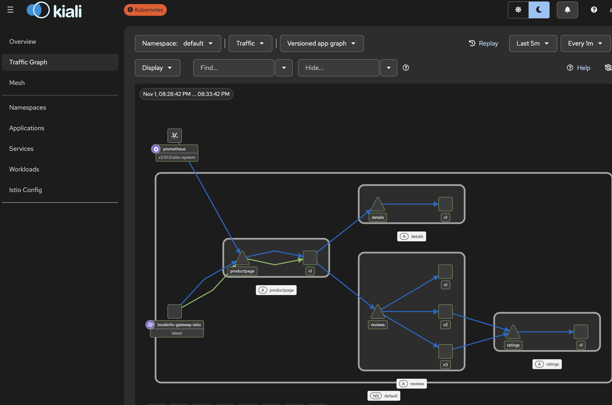
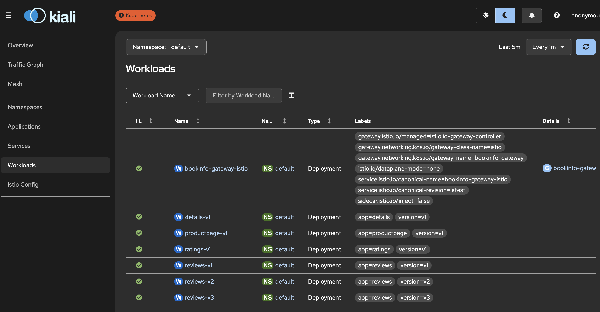

## 5.2. Getting started with Istio service mesh

- [Istio Github Resource](https://github.com/istio/istio/tree/master/samples)

- Install Istio CLI

```sh
curl -L https://istio.io/downloadIstio | sh -
```

- check version:

```sh
ls -d istio-*/
```

version is: `istio-1.31.3`

- Add istioctl to the PATH.

```sh
echo 'export PATH="$HOME/Downloads/istio-1.31.3/bin:$PATH"' >> ~/.zshrc
```

- Verify the CLI installation.

```sh
istioctl version
```

`Istio is not present in the cluster: no running Istio pods in namespace "istio-system"
client version: 1.31.3`

- Prepare the k3d cluster
- I want to fresh start the cluster in clean environment for Istio Ambient, I also dont need existing Traefik, so first remove `k3s-default`cluster:

```sh
k3d cluster delete k3s-default
```

- re-create `k3s-default` cluster with traefik disabled:

```sh
k3d cluster create k3s-default \
  --servers 1 \
  --agents 2 \
  --image rancher/k3s:v1.31.6-k3s1 \
  --port "9080:80@loadbalancer" \
  --port "9443:443@loadbalancer" \
  --k3s-arg "--disable=traefik@server:0"
```

Install Istio Ambient

```sh
istioctl install --set profile=ambient --set values.global.platform=k3d
```

```table
✔ Istio core installed ⛵️
✔ CNI installed 🪢                                                                                    .
✔ Istiod installed 🧠
✔ Ztunnel installed 🔒
✔ Installation complete
The ambient profile has been installed successfully, enjoy Istio without sidecars!
```

- verify all Istio pods are Running:

```sh
kubectl get pods -n istio-system -o wide
```

Install the Kubernetes Gateway API CRDs required for traffic routing.

```sh
kubectl apply -f https://github.com/kubernetes-sigs/gateway-api/releases/download/v1.3.0/standard-install.yaml
```

- verify installation:

```sh
kubectl get crd gateways.gateway.networking.k8s.io httproutes.gateway.networking.k8s.io
```

```table
NAME                                   CREATED AT
gateways.gateway.networking.k8s.io     2026-11-01T12:33:31Z
httproutes.gateway.networking.k8s.io   2026-11-01T12:33:31Z
```

Deploy the Bookinfo sample application

```sh
kubectl apply -f samples/bookinfo/platform/kube/bookinfo.yaml
```

- check pods:

```sh
kubectl get pods
```

```table
NAME                              READY   STATUS    RESTARTS   AGE
details-v1-559684c7b4-hh9n8       1/1     Running   0          29s
productpage-v1-658db8b685-svh65   1/1     Running   0          28s
ratings-v1-75484f7ffb-dqrd7       1/1     Running   0          29s
reviews-v1-5f65fdff4d-m9tcj       1/1     Running   0          28s
reviews-v2-f45c5695b-b6dlt        1/1     Running   0          28s
reviews-v3-77f747dc48-r8qdx       1/1     Running   0          28s
```

- Enable Ambient Mesh. Add the sample application namespace to the Ambient mesh.

```sh
kubectl label namespace default istio.io/dataplane-mode=ambient
```

- verify the label:

```sh
kubectl get namespace default --show-labels
```

```table
NAME      STATUS   AGE   LABELS
default   Active   18h   istio.io/dataplane-mode=ambient,kubernetes.io/metadata.name=default
```

- verify ambient enrollment:

```sh
istioctl ztunnel-config workloads
```

```table
NAMESPACE    POD NAME                                ADDRESS    NODE                     WAYPOINT PROTOCOL
default      details-v1-559684c7b4-hh9n8             10.42.2.5  k3d-k3s-default-server-0 None     HBONE
default      kubernetes                              172.18.0.3                          None     TCP
default      productpage-v1-658db8b685-svh65         10.42.0.7  k3d-k3s-default-agent-0  None     HBONE
default      ratings-v1-75484f7ffb-dqrd7             10.42.2.6  k3d-k3s-default-server-0 None     HBONE
default      reviews-v1-5f65fdff4d-m9tcj             10.42.0.5  k3d-k3s-default-agent-0  None     HBONE
default      reviews-v2-f45c5695b-b6dlt              10.42.0.6  k3d-k3s-default-agent-0  None     HBONE
default      reviews-v3-77f747dc48-r8qdx             10.42.2.7  k3d-k3s-default-server-0 None     HBONE
istio-system istio-cni-node-2dt7m                    10.42.0.3  k3d-k3s-default-agent-0  None     TCP
istio-system istio-cni-node-56x99                    10.42.1.3  k3d-k3s-default-agent-1  None     TCP
istio-system istio-cni-node-wcg8d                    10.42.2.3  k3d-k3s-default-server-0 None     TCP
istio-system istiod-5f96585668-md2mq                 10.42.1.4  k3d-k3s-default-agent-1  None     TCP
istio-system ztunnel-7c4vr                           10.42.2.4  k3d-k3s-default-server-0 None     TCP
istio-system ztunnel-cqm97                           10.42.0.4  k3d-k3s-default-agent-0  None     TCP
istio-system ztunnel-sntz4                           10.42.1.5  k3d-k3s-default-agent-1  None     TCP
kube-system  coredns-ccb96694c-hch58                 10.42.1.6  k3d-k3s-default-agent-1  None     TCP
kube-system  local-path-provisioner-5b5f758bcf-zkc75 10.42.1.2  k3d-k3s-default-agent-1  None     TCP
kube-system  metrics-server-7bf7d58749-2dd5j         10.42.0.2  k3d-k3s-default-agent-0  None     TCP
```

- All Bookinfo application pods appear in the Ambient mesh
- to create the bookinfo gateway, we need to check the gateway api first:

```sh
ls samples/bookinfo/gateway-api
```

```table
bookinfo-gateway.yaml		route-reviews-90-10.yaml
route-all-v1.yaml		route-reviews-v1.yaml
route-reviews-50-v3.yaml	route-reviews-v3.yaml
```

- apply the bookinfo gateway:

```sh
kubectl apply -f samples/bookinfo/gateway-api/bookinfo-gateway.yaml
```

- check the gateway:

```sh
kubectl get gateway
```

```table
NAME               CLASS   ADDRESS      PROGRAMMED   AGE
bookinfo-gateway   istio   172.18.0.3   True         81s
```

- lets curl the bookinfo application at:

```sh
curl -I http://localhost:9080/productpage
```

- we see response that confirms that the complete external access path is wroking now:

```table
HTTP/1.1 200 OK
server: istio-envoy
date: Sun, 01 Nov 2026 13:11:56 GMT
content-type: text/html; charset=utf-8
content-length: 15070
vary: Cookie
x-envoy-upstream-service-time: 1082
```

- also the bookinfor site is up and running : `http://localhost:9080/productpage`
- verify all bookinfo pods show `HBONE protocol`

```sh
istioctl ztunnel-config workloads
```

```table
NAMESPACE    POD NAME                                    ADDRESS    NODE                     WAYPOINT PROTOCOL
default      bookinfo-gateway-istio-86f8dcd484-4qfnj     10.42.2.9  k3d-k3s-default-server-0 None     TCP
default      details-v1-559684c7b4-hh9n8                 10.42.2.5  k3d-k3s-default-server-0 None     HBONE
default      kubernetes                                  172.18.0.3                          None     TCP
default      productpage-v1-658db8b685-svh65             10.42.0.7  k3d-k3s-default-agent-0  None     HBONE
default      ratings-v1-75484f7ffb-dqrd7                 10.42.2.6  k3d-k3s-default-server-0 None     HBONE
default      reviews-v1-5f65fdff4d-m9tcj                 10.42.0.5  k3d-k3s-default-agent-0  None     HBONE
default      reviews-v2-f45c5695b-b6dlt                  10.42.0.6  k3d-k3s-default-agent-0  None     HBONE
default      reviews-v3-77f747dc48-r8qdx                 10.42.2.7  k3d-k3s-default-server-0 None     HBONE
```

- get the PeerAuthentication result:

````sh
kubectl get peerauthentication -A
```sh
kubectl get pods -n istio-system -l app=ztunnel
````

```table
NAME            READY   STATUS    RESTARTS   AGE
ztunnel-7c4vr   1/1     Running   0          22h
ztunnel-cqm97   1/1     Running   0          22h
ztunnel-sntz4   1/1     Running   0          22h
```

- next, we install Prometheus as kiali requires Prometheus to be installed in the cluster.
- We have Helm repo already installed. So, lets just update it:

```sh
helm repo update
```

- add the Istio Prometheus addon to the cluster:

```sh
kubectl apply -f samples/addons/prometheus.yaml
```

- Now check only prometheus pod is running in istio-system namespace:

```sh
kubectl get pods -n istio-system | grep prometheus
```

`prometheus-69b84c6cf6-sf2gk   2/2     Running   0          60s`

- also check its service:

```sh
kubectl get svc prometheus -n istio-system
```

```table
NAME         TYPE        CLUSTER-IP    EXTERNAL-IP   PORT(S)    AGE
prometheus   ClusterIP   10.43.93.74   <none>        9090/TCP   2m20s
```

- Install kiali. Like Prometheus, kiali is also an Istio addon. So, we can install it using the Istio addon manifest.

```sh
kubectl apply -f samples/addons/kiali.yaml
```

- verify installed kiali pod:

```sh
kubectl get pods -n istio-system | grep kiali
```

```table
kiali-7f7fc9b955-7wp2x        1/1     Running   0          3m35s
```

- verify kaili service:

```sh
kubectl get svc kiali -n istio-system
```

- open kaili dashboard by port-forwarding.

```sh
kubectl port-forward svc/kiali 20001:20001 -n istio-system
```

- kiali dasboard is now accessible at: `http://localhost:20001/kiali/console`

### Configure kiali to use Prometheus

kiali requires Prometheus to collect metrics and display service traffic in its graph. I installed the official Istio Prometheus addon instead:

```sh
kubectl apply -f samples/addons/prometheus.yaml
```

This created a Prometheus service in the `istio-system` namespace, exposing port `9090`.

I configured kiali's ConfigMap using:

```sh
KUBE_EDITOR=nano kubectl edit configmap kiali -n istio-system
```

Under `external_services`, I added the Prometheus service URL:

```yaml
external_services:
  prometheus:
    enabled: true
    url: http://prometheus.istio-system:9090
```

Finally, I restarted kiali to apply the configuration:

```sh
kubectl rollout restart deployment/kiali -n istio-system
```

Verified that kiali was running and successfully displaying Bookinfo traffic in its Graph view.

### kiali_Traffic_Graph



### kiali_Workload



### Clearn Up

- remove gateway, bookinfo application:

```sh
kubectl delete -f samples/bookinfo/gateway-api/bookinfo-gateway.yaml
kubectl delete -f samples/bookinfo/platform/kube/bookinfo.yaml
```
