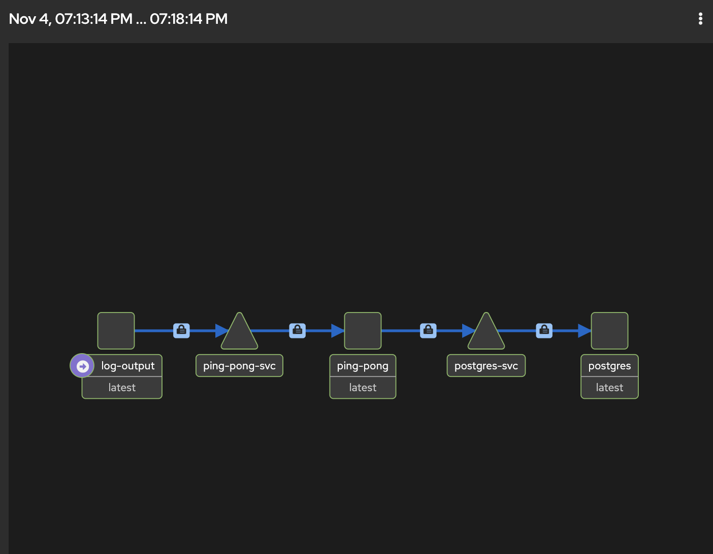
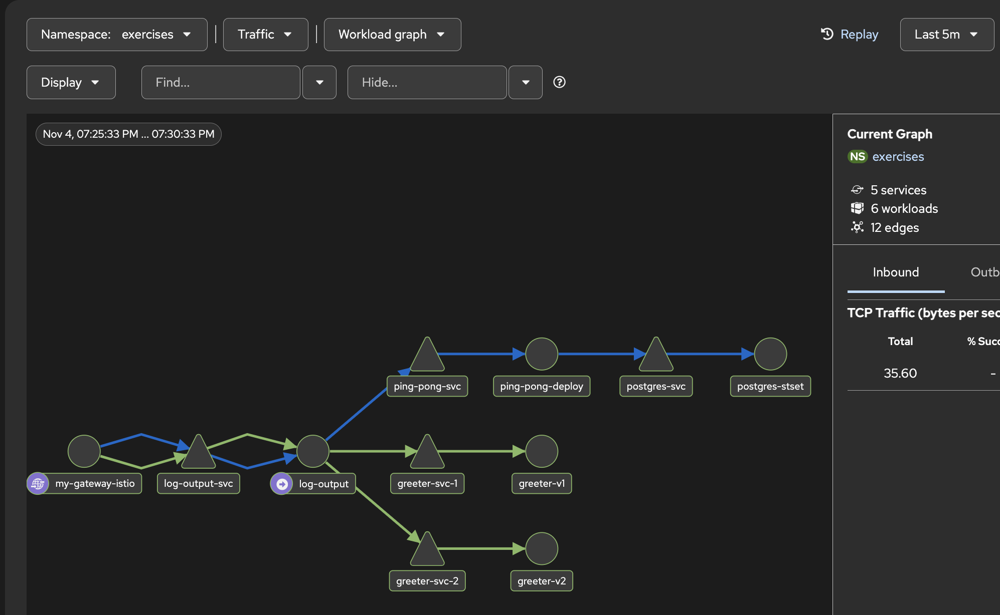

# Ex: 5.3. Log app, the Service Mesh Edition

- we will use previous setup from ex 4.7 for ping_pong and log_output with necessary changes to make it work with istio service mesh.
- we create namespace `exercises` and label this namespace for istio to include its workload in the service mesh.

```sh
kubectl create namespace exercises
kubectl label namespace exercises istio.io/dataplane-mode=ambient
```

- for log_output to work, we also need to make ping_pong working along with the PostgreSQL.

```sh
kubectl apply -f ex_5.3/ping_pong/manifests/postgres.yaml
```

- connect to postgres, create table `counter` and insert default id and value:

```sql
CREATE TABLE counter (
    id SERIAL PRIMARY KEY,
    value INTEGER NOT NULL DEFAULT 0
);

INSERT INTO counter (id, value) VALUES (1, 0);
```

- building ping pong image using the same tag which was used in previous exercise so that other resources which are using this image will not be affected.

```sh
docker build -t ping_pong:ex-4.1 ./ex_5.3/ping_pong
```

- import into k3d:

```sh
k3d image import ping_pong:ex-4.1 -c k3s-default
```

- apply deployment and service:

```sh
kubectl apply -f ex_5.3/ping_pong/manifests/deployment.yaml
kubectl apply -f ex_5.3/ping_pong/manifests/service.yaml
```

- check pods and services:

```sh
kubectl get pods,svc -n exercises
```

```table
NAME                                    READY   STATUS    RESTARTS   AGE
pod/ping-pong-deploy-576fd689ff-v77ps   1/1     Running   0          34s
pod/postgres-stset-0                    1/1     Running   0          136m

NAME                    TYPE        CLUSTER-IP     EXTERNAL-IP   PORT(S)    AGE
service/ping-pong-svc   ClusterIP   10.43.197.20   <none>        3000/TCP   28s
service/postgres-svc    ClusterIP   10.43.10.144   <none>        5432/TCP   136m
```

- test from inside the ping pong pod:

```sh
kubectl exec -it -n exercises deploy/ping-pong-deploy -- wget -qO- http://localhost:3000/
kubectl exec -it -n exercises deploy/ping-pong-deploy -- wget -qO- http://localhost:3000/pings
```

- we can see the counter value is increasing and displaying properly.
- create greeter services running at port 3000 and
- we create two greeter deployments with different versions.
- created dedicated `/greeter/index.js` file for greeter service with responds version message based on versions:

```javascript
res.end(`Hello from version ${VERSION}`);
```

- build greeter image and import into k3d:

```sh
docker build -t greeter:ex-5.3 ./ex_5.3/greeter
k3d image import greeter:ex-5.3 -c k3s-default
```

- create deployment-v1.yaml and deployment-v2.yaml for greeter service with different versions.
- create related services one for Greeter v1, one for Greeter v2 and one for Greeter with no version, to select between them.
- apply all the manifests for greeter service:

```sh
kubectl apply -f ex_5.3/greeter/manifests/deployment-v1.yaml
kubectl apply -f ex_5.3/greeter/manifests/deployment-v2.yaml
kubectl apply -f ex_5.3/greeter/manifests/service.yaml
```

- verify resources:

```sh
kubectl get pods,deployments,svc -n exercises
```

```table
NAME                                    READY   STATUS    RESTARTS   AGE
pod/greeter-v1-5955498fff-hgd9s         1/1     Running   0          55s
pod/greeter-v2-9ccd6f947-vm5cq          1/1     Running   0          49s
pod/ping-pong-deploy-576fd689ff-v77ps   1/1     Running   0          51m
pod/postgres-stset-0                    1/1     Running   0          3h8m

NAME                               READY   UP-TO-DATE   AVAILABLE   AGE
deployment.apps/greeter-v1         1/1     1            1           55s
deployment.apps/greeter-v2         1/1     1            1           49s
deployment.apps/ping-pong-deploy   1/1     1            1           51m

NAME                    TYPE        CLUSTER-IP      EXTERNAL-IP   PORT(S)    AGE
service/greeter-svc     ClusterIP   10.43.111.88    <none>        3000/TCP   43s
service/greeter-svc-1   ClusterIP   10.43.175.188   <none>        3000/TCP   43s
service/greeter-svc-2   ClusterIP   10.43.223.49    <none>        3000/TCP   43s
service/ping-pong-svc   ClusterIP   10.43.197.20    <none>        3000/TCP   51m
service/postgres-svc    ClusterIP   10.43.10.144    <none>        5432/TCP   3h8m
```

- we have all three selectors in place `greeter-svc`, `greeter-svc-1` and `greeter-svc-2`
- create waypoint proxy that provides traffic management. It allows Istio to inspect HTTP requests and apply our weighted routing rules:

```sh
istioctl waypoint apply --namespace exercises --name greeter-waypoint
```

`✅ waypoint exercises/greeter-waypoint applied`

- verify waypooint proxy is running:

```sh
 kubectl get gateway -n exercises
```

```table
NAME               CLASS            ADDRESS      PROGRAMMED   AGE
greeter-waypoint   istio-waypoint   10.43.56.4   True         3m1s
```

- Attach the waypoint to the common service `greeter-svc`:

```sh
kubectl label service greeter-svc -n exercises istio.io/use-waypoint=greeter-waypoint
```

- then makesure the label is applied:

```sh
kubectl get service greeter-svc -n exercises --show-labels
```

```table
NAME          TYPE        CLUSTER-IP     EXTERNAL-IP   PORT(S)    AGE   LABELS
greeter-svc   ClusterIP   10.43.111.88   <none>        3000/TCP   13m   istio.io/use-waypoint=greeter-waypoint
```

- Now we can configure the traffic routing split based on weighted percentages. For this added a configuration file `httproute.yaml` adding `greeter-svc`as parent and `greeter-svc-1` and `greeter-svc-2`as backend references with weights `75%` and `25%` respectively.
- then apply the traffic splitting `HttpRoute`configuration:

```sh
kubectl apply -f ex_5.3/greeter/manifests/httproute.yaml
```

- check status:

```sh
kubectl get httproute greeter-route -n exercises
```

```table
NAME            HOSTNAMES   AGE
greeter-route               8s
```

```sh
kubectl describe httproute greeter-route -n exercises
```

- the above command shows the logs as in the followoing table where reasons and status are true.

```table
      Reason:                Accepted
      Status:                True

      Reason:                ResolvedRefs
      Status:                True

      Reason:                ResolvedWaypoints
      Status:                True
```

- test Greeter traffic splitting by sending repeated requests in a loop and checking whether both versions respond, approximately 75% v1 and 25% v2.
- we add /status endpoint in log_output/index.js and call parent service: `greeter-svc`at `3000` port:

```javascript
const GREETER_URL = "http://greeter-svc:3000";
```

- then receives the greeting message based on greeter service versions

```javascript
res.end(`Hello from version ${VERSION}`);
```

```sh
kubectl exec -n exercises deploy/greeter-v1 -- sh -c '
for i in $(seq 1 100); do
  wget -qO- http://greeter-svc:3000
done | sort | uniq -c
'
```

- the above generates the outputs about 75% for `Hello from version 1`and 25 for `Hello from version 2`

- build and deploy the updated Log output:

```sh
docker build -t log-output:ex-5.3 ./ex_5.3/log_output
```

```sh
k3d image import log-output:ex-5.3 -c k3s-default
```

- Apply the Log Output resources:

```sh
kubectl apply -f ex_5.3/log_output/manifests/configmap.yaml
kubectl apply -f ex_5.3/log_output/manifests/service.yaml
kubectl apply -f ex_5.3/log_output/manifests/deployment.yaml
```

```sh
kubectl get deployment,pods,svc -n exercises
```

- above logs show all rescources are running 1/1

- Let's check whether log-output can now communicate with both Ping-Pong and Greeter

```sh
kubectl exec -n exercises deploy/log-output -- wget -qO- http://localhost:3000/status
```

```table
file content: this text is from file
env variable: MESSAGE=hello world
2026-11-04T16:42:17.158Z: 3435086eb1e6c8ff5c9a20eef0af70f8.
Ping / Pongs: 2

greetings: Hello from version 1
```

- hence, log output successfully communicates with both ping-pong and greeter.
- our logoutput gateway.yaml uses `gatewayClassName: gke-l7-global-external-managed` which was meant for GKS cluster in earlier exercises, so we change it to `istio` instead.
  `gatewayClassName: istio`
- apply gateway and route configurations:

```sh
kubectl apply -f ex_5.3/log_output/manifests/gateway.yaml
kubectl apply -f ex_5.3/log_output/manifests/route.yaml
```

- verify gateway and httproute in exercises namespace:

```sh
kubectl get gateway,httproute -n exercises
```

```table
NAME                                                 CLASS            ADDRESS      PROGRAMMED   AGE
gateway.gateway.networking.k8s.io/greeter-waypoint   istio-waypoint   10.43.56.4   True         21h
gateway.gateway.networking.k8s.io/my-gateway         istio            172.18.0.3   True         13s

NAME                                                HOSTNAMES   AGE
httproute.gateway.networking.k8s.io/greeter-route               20h
httproute.gateway.networking.k8s.io/my-route                    7s
```

- several requests at `http://localhost:9080/` clearly shows greetings message served 75%, 25% from `greeter-svc-1` and `greeter-svc-2`.
- we should verify the traffic distribution visually in Kiali for demonstrating service mesh observability.
- inspect kiali pod and services in istio-system namespace:

```sh
kubectl get pods -n istio-system
kubectl get svc -n istio-system
```

- open kiali locally:

```sh
kubectl port-forward -n istio-system svc/kiali 20001:20001
```

- my kiali dashboard opens properly: `http://localhost:20001/kiali/console/overview?refresh=60000&duration=300`
- Kiali -> graph -> namespace (exerises)-> workload graph before hitting 100 requests:

### before multiple requests, there is little visibility in Traffic:



### after sending 100s of requests Kiali shows traffic from Log Output to both greeter versions with different weights:


